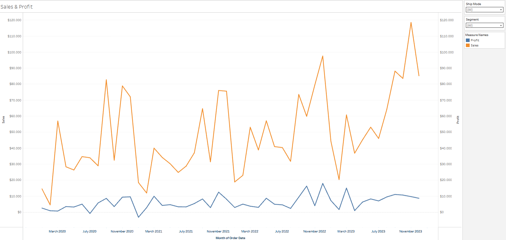
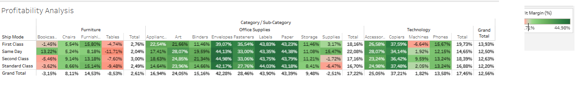
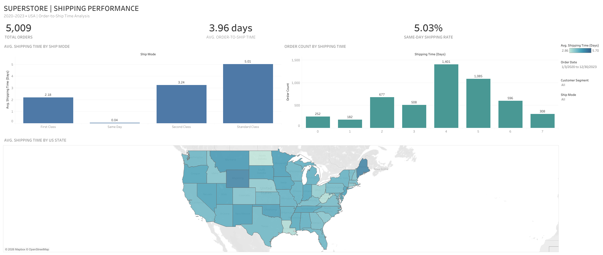

# Superstore Sales & Shipping Analysis

## Project Overview

This project analyzes **sales, profitability, and order-to-shipment performance** using the Sample Superstore dataset for **2020–2023**. The objective is to explore commercial performance over time, compare profit margins across product groups, and identify differences in shipping patterns across the United States.

An interactive Tableau dashboard brings together key performance indicators (KPIs), shipping-method comparisons, order distributions, and a geographic view of processing times.

**[View the interactive dashboard on Tableau Public](https://public.tableau.com/views/SuperstoreSalesShippingAnalysis_17946629183810/GnderimPerformans)**


## Tools and Technologies

- **Tableau Public:** Data visualization, dashboard development, and interactive filtering
- **Calculated Fields:** Custom business metrics and derived date measures
- **Dual-Axis Time Series:** Monthly sales and profit comparisons
- **DATEDIFF, COUNTD, SUM, AVG:** Shipping-time, distinct-order, profitability, and average calculations
- **Geographic Mapping:** State-level shipping performance visualization

## Analysis Process

### 1. Sales and Profit Trends
- Analyzed monthly sales and profit performance from 2020 through 2023.
- Built dual-axis line charts to compare both metrics over time.
- Added customer segment and shipping method filters for focused analysis.



### 2. Profitability Analysis
- Calculated profit margin using total profit divided by total sales, with a zero-sales check.
- Compared profitability by **Category**, **Sub-Category**, and **Ship Mode**.
- Used a diverging color scale and subtotals to highlight negative and positive margins.



### 3. Shipping Performance Analysis
- Calculated days between **Order Date** and **Ship Date** using Tableau's `DATEDIFF` function.
- Analyzed average processing time by shipping method and distinct-order counts by shipping-day interval.
- Mapped average order-to-ship time across US states and built an interactive dashboard with date, segment, and ship mode filters.



## Key Results

| KPI | Result |
| --- | ---: |
| Total orders (distinct) | **5,009** |
| Average order-to-ship time | **3.96 days** |
| Same-day shipping rate | **5.03%** |
| Most frequent shipping interval | **4 days — 1,401 orders** |

**Additional observations:** Standard Class had the longest average order-to-ship time (**5.01 days**), compared with **3.24 days** for Second Class and **2.18 days** for First Class.

## Selected Tableau Calculations

```tableau
// Order-to-ship time (days)
DATEDIFF('day', [Order Date], [Ship Date])

// Profit margin
IF SUM([Sales]) != 0 THEN
    SUM([Profit]) / SUM([Sales])
END

// Distinct order count
COUNTD([Order ID])

// Same-day shipping rate
COUNTD(IF [Shipping Time (Days)] = 0 THEN [Order ID] END)
/
COUNTD([Order ID])
```

## Project Deliverables

| File | Description |
| --- | --- |
| [Tableau Workbook](tableau/Superstore-Sales-Shipping-Analysis.twbx) | Packaged Tableau workbook with worksheets, calculated fields, and dashboard |
| [Sales & Profit Screenshot](assets/sales-profit.png) | Monthly sales and profit trends |
| [Profitability Screenshot](assets/profitability-analysis.png) | Profit margins by category and shipping method |
| [Shipping Performance Screenshot](assets/shipping-performance.png) | Shipping KPIs, order distributions, and US state map |
| [Live Dashboard](https://public.tableau.com/views/SuperstoreSalesShippingAnalysis_17946629183810/GnderimPerformans) | Published dashboard on Tableau Public |

## Data Source

[Sample Superstore dataset](https://docs.google.com/spreadsheets/d/1B6NRip0PBVx9uUgYYUO6iczNwOnSJCPO/edit?gid=580066455#gid=580066455)

**Metric definition:** Shipping time represents the period from order placement to shipment, **not** the final delivery time to the customer.
